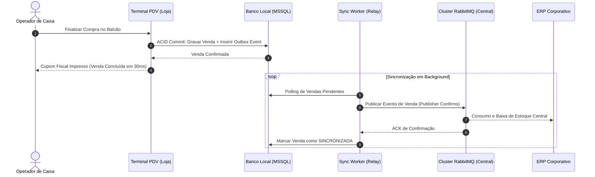

# 🏬 Retail Order Sync Engine
> **Motor Corporativo de Sincronização de Pedidos e Vendas de PDV para Redes de Lojas**  
> *Arquitetura Resiliente de Alta Confiabilidade para Integração de PDVs Físicos e ERP Central via RabbitMQ*

---

## 💼 O Problema de Negócio (Cenário de Varejo e Lojas Físicas)
Em redes de lojas físicas com múltiplos Pontos de Venda (PDVs) operando simultaneamente, cada venda realizada no caixa precisa:
1. Gravar localmente no banco do caixa/loja com confirmação fiscal imediata para o cliente no balcão.
2. Disparar a baixa de estoque e o faturamento no ERP Corporativo central (ex: Sankhya, SAP, Totvs) em tempo real.

**O Desafio:** Quedas de internet na loja ou instabilidades no ERP central provocam o *Dual-Write Problem*. Se o caixa salva a venda mas o broker/ERP falha, o estoque fica desincronizado e a contabilidade fura. Se o caixa trava aguardando o ERP central, forma-se fila no caixa da loja física.

## 🚀 A Solução Técnica
O **Retail Order Sync Engine** desacopla a finalização da venda local do envio para a nuvem através do padrão **Transactional Outbox**:
- A venda e o registro de sincronização são gravados na mesma transação ACID local.
- O caixa emite o cupom em milissegundos sem esperar resposta de rede externa.
- Um worker de relay assíncrono monitora os eventos de venda e realiza a entrega idempotente no cluster RabbitMQ corporativo.
- Em caso de queda de link, o sistema aplica retry inteligente com backoff exponencial e direciona falhas persistentes para Dead Letter Queue (DLQ) com alertas para o time de suporte via Datadog.



## 🛠️ Tecnologias
- **TypeScript & Node.js 20**
- **RabbitMQ & Mensageria Corporativa**
- **Clean Architecture & Domain Events**
- **Testes Automatizados de Resiliência**

## 🧪 Execução dos Testes
```bash
npm install
npm test
npm start
```
